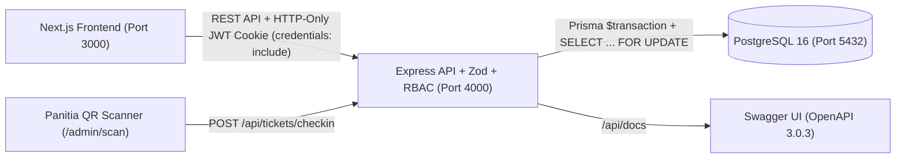
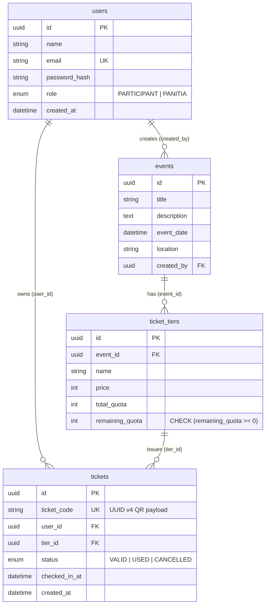

# TixFlow — Concurrent Campus Event Ticketing & QR Access System

Sistem manajemen *ticketing* event kampus berbasis arsitektur *full-stack* yang dirancang untuk menangani **rebutan kuota tiket secara konkuren (anti-overselling)** dan **validasi akses gerbang menggunakan QR Code** secara atomik.

## Tech Stack
- **Frontend:** Next.js 15 (App Router), React 19, TypeScript, Tailwind CSS, `qrcode.react`, `html5-qrcode`, `lucide-react`
- **Backend:** Node.js 22, Express, TypeScript, Zod (validasi input), Swagger UI (`swagger-ui-express`)
- **Database & ORM:** PostgreSQL 16 + Prisma ORM (dengan SQL migration & `CHECK (remaining_quota >= 0)`)
- **Security & Auth:** `bcrypt` password hashing, `jsonwebtoken` (HTTP-Only Cookie `tixflow_token`), RBAC (`PARTICIPANT` vs `PANITIA`), `helmet`, `express-rate-limit`
- **Infrastructure:** Multi-stage Docker & Docker Compose (`db`, `backend`, `frontend`)

---

## System Architecture



---

## Database Schema (ERD — 4 Tables)



---

## Mekanisme Anti-Overselling & Atomic Check-in

### 1. Transactional Booking (`POST /api/tickets/book`)
Saat banyak peserta memesan kategori tiket yang sama pada detik yang sama, pengecekan kuota biasa (`read` lalu `update`) rentan terhadap *race condition* (TOCTOU) sehingga kuota dapat menjadi negatif (*overselling*).

TixFlow mencegah hal tersebut dengan dua lapis proteksi di [ticket.controller.ts](backend/src/controllers/ticket.controller.ts) dan [migration.sql](backend/prisma/migrations/20261125000000_init/migration.sql):
1. **Pessimistic Row-Level Locking di dalam `prisma.$transaction`:**
   ```sql
   SELECT id, remaining_quota
   FROM ticket_tiers
   WHERE id = $1::uuid
   FOR UPDATE
   ```
   Baris `ticket_tiers` yang dipilih dikunci hingga transaksi selesai (*commit* atau *rollback*). Request paralel lain mengantre di tingkat database.
2. **Validasi Kuota + Constraint Database:**
   - Jika `remaining_quota <= 0`, server melempar `409 Conflict` sehingga transaksi di-*rollback* tanpa mengurangi kuota atau menerbitkan tiket.
   - Database PostgreSQL juga menegakkan `CONSTRAINT "ticket_tiers_remaining_quota_check" CHECK ("remaining_quota" >= 0)` sebagai jaring pengaman terakhir.

### 2. Atomic Check-in (`POST /api/tickets/checkin`)
Untuk mencegah satu QR Code dipindai dua kali secara bersamaan di dua perangkat scanner panitia:
- Endpoint menjalankan operasi atomik tunggal:
  ```ts
  prisma.ticket.updateMany({
    where: { ticketCode, status: TicketStatus.VALID },
    data: { status: TicketStatus.USED, checkedInAt },
  })
  ```
- Hanya satu request yang mendapatkan `count === 1` (`200 OK`). Request paralel kedua selalu mendapat `count === 0` dan langsung ditolak dengan `409 Conflict` (`Ticket already used`).

---

## REST API Contract

Dokumentasi interaktif Swagger UI tersedia di **`http://localhost:4000/api/docs`** (dan OpenAPI JSON di `/api/docs.json`).

| Method | Endpoint | Akses | Deskripsi |
| :--- | :--- | :--- | :--- |
| `GET` | `/api/health` | Public | Health check backend |
| `POST` | `/api/auth/register` | Public | Registrasi akun (`PARTICIPANT` default) + set cookie JWT |
| `POST` | `/api/auth/login` | Public | Login + set HTTP-only JWT cookie (`tixflow_token`) |
| `POST` | `/api/auth/logout` | Public | Hapus cookie sesi |
| `GET` | `/api/auth/me` | Authenticated | Ambil profil user aktif |
| `GET` | `/api/events` | Public | Daftar seluruh event & tier tiket |
| `GET` | `/api/events/:id` | Public | Detail event & sisa kuota tier |
| `POST` | `/api/events` | `PANITIA` only | Buat event baru |
| `POST` | `/api/events/:id/tiers` | `PANITIA` only | Tambah kategori tiket pada event |
| `POST` | `/api/tickets/book` | `PARTICIPANT` only | Booking tiket dengan `FOR UPDATE` row locking |
| `GET` | `/api/tickets/my` | `PARTICIPANT` only | Daftar tiket milik user beserta `ticketCode` |
| `POST` | `/api/tickets/checkin` | `PANITIA` only | Validasi QR Code tiket secara atomik |

---

## Cara Menjalankan via Docker Compose

### Prasyarat
- Docker & Docker Compose v2+

### Menjalankan Seluruh Stack (`db`, `backend`, `frontend`)
```bash
docker compose up --build
```
Atau di background:
```bash
docker compose up -d --build
```

> **Catatan Port PostgreSQL:** Secara default `db` memetakan port `5432:5432`. Jika port `5432` sudah dipakai service lain di host Anda, jalankan dengan override port host:
> ```bash
> POSTGRES_PORT=5433 docker compose up -d --build
> ```

Saat container `backend` menyala, entrypoint ([docker-entrypoint.sh](backend/docker-entrypoint.sh)) otomatis menjalankan `npx prisma migrate deploy` dan seed idempoten (`node dist/seed.js`) sebelum menyalakan server Express.

### URL Layanan
- **Frontend (Next.js App):** http://localhost:3000
- **Backend API:** http://localhost:4000
- **Swagger UI:** http://localhost:4000/api/docs
- **PostgreSQL 16:** `localhost:5432` (atau `$POSTGRES_PORT`)

### Akun Demo Hasil Seed Otomatis
| Role | Email | Password |
| :--- | :--- | :--- |
| `PANITIA` | `panitia@tixflow.test` | `Panitia123!` |
| `PARTICIPANT` | `peserta@tixflow.test` | `Peserta123!` |

### Menghentikan & Menghapus Container
```bash
docker compose down -v
```

---

## Bukti Hasil Concurrency Test (Fase 3)

Skrip [backend/scripts/test-concurrency.ts](backend/scripts/test-concurrency.ts) (`npm run test:concurrency`) mengirim **10 request paralel** `POST /api/tickets/book` ke 1 tier dengan `remaining_quota = 1` pada PostgreSQL 16 aktif, lalu menguji **2 request paralel** `POST /api/tickets/checkin` terhadap tiket yang terbit:

```text
> tixflow-backend@1.0.0 test:concurrency
> tsx scripts/test-concurrency.ts

=== TixFlow Concurrency Test ===
Server URL: http://127.0.0.1:54458
Event ID:   da81601e-d30a-4639-b5e1-ba4650d44c07
Tier ID:    1dd9eb35-b97e-425f-b10c-9ed96ba28a84 (initial remaining_quota = 1)
Firing 10 parallel POST /api/tickets/book requests...

Request #01 -> HTTP 201 (success)
Request #02 -> HTTP 409 (error: Ticket quota is sold out)
Request #03 -> HTTP 409 (error: Ticket quota is sold out)
Request #04 -> HTTP 409 (error: Ticket quota is sold out)
Request #05 -> HTTP 409 (error: Ticket quota is sold out)
Request #06 -> HTTP 409 (error: Ticket quota is sold out)
Request #07 -> HTTP 409 (error: Ticket quota is sold out)
Request #08 -> HTTP 409 (error: Ticket quota is sold out)
Request #09 -> HTTP 409 (error: Ticket quota is sold out)
Request #10 -> HTTP 409 (error: Ticket quota is sold out)

--- Booking Summary ---
201 Created:         1
409 Conflict:        9
Other statuses:      0
remaining_quota:     0
Tickets in DB:       1

Firing 2 parallel POST /api/tickets/checkin requests...
--- Check-in Summary ---
200 OK:              1
409 Conflict:        1
Final ticket status: USED

PASS: Concurrency control (0 overselling, 0 double check-in) verified.
```
